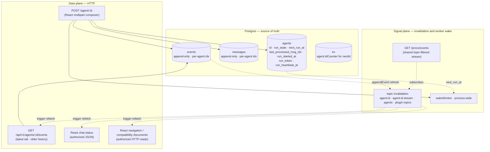

# Architecture

## Direction

The primary shell is React/Vite in `frontend/`, served at `/`. Trusted browser extensions use the local `@mauzcode/ui` SDK and explicit grants for pages, navigation, panels and actions. React/React DOM is supplied by the host; private imports and a second runtime are not supported. See [ui-architecture.md](ui-architecture.md) for the actual contract, not the older SSR extension mechanisms below.

`/old-ui` redirects supported entry links to the primary shell. Shared SSR, Canvas content and approval compatibility surfaces remain; retirement of that entry does not authorize removal of their renderers/assets. Frontend grants/readOnly are not security boundaries: backend authentication, ownership, CSRF and explicit human approval still apply. SDK writes require a cookie-bound CSRF token; live subscriptions require resync, error handling, topic declarations and cleanup.

Built-in screens live in `frontend/src/core-ui/` (granted in `extensions/installed.ts`); plugin UIs live in `<plugin>/ui/` with `package.json` `procs.ui` grants and are built by the backend at runtime and loaded through `/plugins/ui/manifest` (non-official ones after human approval of the bundle hash; see docs/ui-architecture.md). The SDK example is a test fixture in `frontend/src/test/fixtures/sdk-example.tsx`. Dead `legacyUi.rewriteResponse`/`navigationUrl` helpers are removed; `procs.http.toResponse` still dynamically dispatches HTTP strings/`{ main }` through `ui.layout`. People `/auth/users`, `sidebar.draft`, built-in/plugin SSR pages, Canvas kind renderers/assets and secure input transports remain live: see the [residual consumer map](ui-architecture.md#residual-compatibility-consumers). SSH settings uses a callback to the native `llm-connections` tab, not `/llms`.

Shared compatibility is concrete: `src/procs/http/toResponse.ts` dynamically resolves `ui.layout` for HTTP strings/`{ main }`; `src/ui/layout.ts` supplies a minimal document, not the removed shell. `canvas.itemDocument` retains HTML/assets previews where no granted React kind replaces them. `input.compatView` retains protected card transports; Redmine approval remains a separate confirmation authority, not generic input submission or a React grant. Do not delete these consumers because the shell migrated.

## Navigation data and compatibility declarations

React owns navigation presentation. Existing `$app`, widget, search and Dock declarations are data/compatibility mechanisms, not automatic registration of React SDK extensions.

A module that owns a user-facing page can publish it to global navigation with a `$app_<name>.json` file. The `nav/$loader_app.ts` loader collects these declarations; `nav.items` reads registered app declarations and can include agent chats; it has no hard-coded core-page catalogue.

The old Dock renderer (`dock.render`) and global menu renderer (`ui.navMenu`, `nav.rows`) are removed. `ui.layout` is a minimal document renderer, not a navigation/chat shell. Dock data, `$dock` loading, layout/pinning functions and `/dock/layout` and `/dock/pin` POST routes still exist; shell retirement is not evidence that these runtime capabilities are absent.

`frontendBridge.searchData` still consumes `nav.tabs` → `nav.effectiveLayout`, so `nav.layout` remains live. `/ui-lab-api/search` returns structured tab/widget/search data from this bridge; HTML-only widgets are unsupported there. `/ui-lab-api/navigation` supplies native navigation data. `GET /nav/items` with `Accept: application/json` returns declared application links (not chats); HTML visits redirect to `/?view=applications`. React Applications can open retained built-in/plugin documents. See `src/frontendBridge/searchData.ts`, `src/nav/tabs.ts` and `src/nav/$route_items_GET.ts`.

Illustrative declaration (the module must implement its destination):

```json
{
  "label": "Example page",
  "href": "/example",
  "hint": "page · example application destination",
  "icon": "ph-clock",
  "group": "System",
  "order": 80
}
```

`label` and `href` are required. `href` must be a local absolute path beginning with a single `/`. `icon` is an optional Phosphor class, `group` selects the global-menu section, and numeric `order` provides stable ordering among app declarations. Defaults are `ph-gear`, `System`, and `100`.

Core static pages use the same declarations as module pages; `nav.items` contains no hard-coded page catalogue. Dynamic plugin pages and agent chats continue to come from their own registries.


**Simplicity first. DB-first. React shell plus compatibility SSR consumers, with topic-filtered SSE invalidation. One in-process worker runs agents in parallel.**

Agent-deferred work uses the unified trigger engine described in [Agent triggers](agent-triggers.md): `agent.wake`, `agent.cron`, and `agent.watch` share durable `agent_triggers` storage and deliver prompts into the same conversation.

Durable conversation state lives in Postgres (paradedb). The scheduling queue is not a separate table — debounce, renewable run lease and run state are columns on `agents`. Realtime uses a shared topic-filtered SSE connection; invalidations trigger authorized HTTP reads of canonical JSON (or HTML for retained compatibility consumers). React also reads transient in-memory stream snapshots through the chat JSON endpoint. Hidden tabs suspend JSON reads; the shared transport releases hidden-tab SSE on HTTP/1.1, while HTTP/2 can keep it connected.



---

## Chat UI ownership

React owns the chat toolbar, Meta panel and Composer. The former SSR chat header/panel, `$chatbadge_`/`$chatbutton_`/`$chatcard_` declarations, loaders and `chat.layout` registry are removed, not extension points. The old model chip, context ring and statusbar HTML routes/renderers are also removed. New trusted UI contributions use the reviewed React SDK registration contract described in [UI architecture](ui-architecture.md).

Domain operations remain independent of rendering: `session.setTitle`, `chat.setIcon`, `chat.sanitizeSvg` and `agent.compactContext`. Icons are stored in `agents.icon`; `chat.icon` remains for existing compatibility list/Dock consumers. Removing the chat registry does not remove secure input transports or shared document rendering.

## Principles

1. **The DB is the source of truth.** Messages, events, run-state, scheduling — all in Postgres. Memory is only an execution cache.
2. **HTTP is the data plane.** Browser fetches visible state through normal short HTTP requests. SSE carries only coalesced invalidation signals; watchdog timers repair missed signals.
3. **Signals are not data.** State invalidations and `wakeWorker` are hints; consumers re-read Postgres or refetch canonical JSON/HTML. Gap resync repairs missing invalidations; compatibility live-region watchdogs provide an additional fallback.
4. **One worker. No worker-job table. Parallel drain.** Run scheduling is two columns on `agents`: `next_run_at` (when to fire) and `run_state` (`'idle' | 'running'`). One in-process `workerLoop` claims every currently-eligible agent in a tight `claimOne()` loop and spawns each as its own promise — different agents run concurrently. Per-agent serialisation is enforced by Postgres row locking on `UPDATE … RETURNING` (two concurrent claims can't both win the same `idle` row), not by an in-memory lock.
5. **Clear rendering ownership.** React owns the primary shell and SDK extension lifecycle. Shared transport handles SSE gaps; HTMX/controllers own only compatibility fragments. Never attach competing controllers to React-owned DOM.

---

## Channels at a glance

The primary entry is `/` (`frontend/src/main.tsx` → `LiveApp`); a selected chat is `/?agent=<id>`. `GET /agent/:id` redirects there with 303. There is no active `/agent/:id/events.html` chat transport. SDK extensions use `requestJson`, not an HTMX form contract.

| Concern | Channel | Driven by |
|---|---|---|
| Initial render | React shell + `GET /api/v1/agents` and `/api/v1/agents/:id/events` | client mount / selected chat |
| Transcript and activity | `GET /api/v1/agents/:id/events`, optional `before` for history | `agent:<id>`, `agent:<id>:stream` invalidations, resync and fallback reads |
| Navigation | `/api/v1/agents`, `/ui-lab-api/navigation`, `/ui-lab-api/search`, `/nav/items` JSON | React consumers and topic invalidation |
| User message | `POST /agent/:id` | React multipart composer with request ID / Idempotency-Key; JSON receipt |
| Stop / archive | `POST /api/v1/agents/:id/stop` and `/archive` | native controls, authorized writes |
| Global notifications | `GET /procs/events` | shared topic-filtered SSE client |

Authentication and surface-specific ownership/write authorization belong on the backend, independently of React grants/readOnly. `src/$middleware.ts` resolves the authenticated visitor and rejects cross-origin writes when authentication is configured; this alone is not a universal per-agent ACL. SDK writes require the cookie-bound CSRF token, not a fabricated Origin. Core/legacy endpoints retain their actual global and route-specific protections; the current React composer does not explicitly attach that token. Protected surfaces enforce their own checks: for example `canvas.authorizeHttp` checks agent ownership, and `input.batchHttp` checks owner access and CSRF. Frontend helpers are not an authorization boundary.

---

## Send flow

```mermaid
sequenceDiagram
    participant B as Browser (React)
    participant S as Server
    participant DB as Postgres
    participant W as workerLoop
    participant L as LLM

    B->>S: POST /agent/:id (multipart text, files, requestId)
    S->>DB: transaction: appendMessage + appendEvent<br/>schedule next_run_at with GREATEST
    Note over S,DB: admission checks and optional attachment writes omitted
    S->>W: wakeWorker
    S-->>B: JSON receipt (messageIdx, sendAt)

    Note over W: claim via<br/>UPDATE agents SET run_state='running'<br/>WHERE id IN (SELECT … WHERE next_run_at <= now LIMIT 1)<br/>RETURNING id

    W->>DB: snapshot userFrontier = MAX(messages.idx) WHERE role='user'
    W->>L: stream(transcript)
    L-->>W: tokens / tool_calls
    W->>DB: appendAssistantMessage / appendEvent / …
    DB-->>S: appendEvent publishes topic agent:id
    S-->>B: SSE invalidation
    B->>S: GET /api/v1/agents/:id/events
    S-->>B: JSON latest tail + activity + transient partial
    Note over B: merge refreshed tail, preserve loaded older history
    W->>DB: fenced finalize WHERE run_token matches;<br/>set idle, clear lease, advance cursor on success,<br/>preserve/reschedule pending user work
    Note over W,DB: transient provider errors retry once;<br/>stale leases use bounded recovery backoff
```

For an immediately accepted ordinary turn, `agent.acceptMessage` persists the message and visible event, schedules the agent and wakes the worker. The React composer calls it through `POST /agent/:id` (`frontend/src/lib/mauzcode.ts`); debounce uses the explicit query override or configured agent/global value (fallback 5 seconds). Duplicate submissions reuse their receipt; a turn submitted during an input wait can instead return `queued: true` and live in `agent_turn_queue` until promotion. This turn queue is distinct from worker scheduling on the agents row. Commands have a separate control path. The diagram shows the ordinary accepted-turn path, not all admission branches.

The separate native API `POST /api/v1/agents/:id/messages` accepts JSON or multipart, defaults to 100 ms debounce, and returns a 202 JSON receipt with `messageIdx`, `eventIdx` and `sendAt`; it is not the current React composer endpoint.

If two POSTs land within the debounce window, both rows are appended to `messages`, and `next_run_at = MAX(...)` keeps the run scheduled for the latest one. When the worker fires, both messages go to the LLM in one transcript — natural merge.

## Receive flow

The browser shares one topic-filtered `GET /procs/events` stream. React state consumers refetch authoritative JSON on invalidations and resync after gaps. SDK subscribers must supply `resync` and `onError`, declare topics and clean up on unmount. Over HTTP/2 hidden tabs may keep the stream; over HTTP/1.1 they release it and catch up on return (see [live-updates.md](live-updates.md)). `useMauzCode` refreshes the latest bounded JSON tail and merges it with already loaded history; it does not consume HTML delta tails. `liveRefresh` serializes reads, aborts on disposal and refetches on reconnect/visibility. Connected fallback is 60 seconds; disconnected fallback is 2.5 seconds for chat, 10 seconds for the agent list. Hidden tabs do no JSON reads. Retained HTML consumers use their separate compatibility transports.


---

## Recovery

| Event | What happens |
|---|---|
| Browser refresh | React reads the selected chat's latest bounded JSON page; older history is loaded with `before`. |
| Lost network | EventSource reconnects; resync refetches canonical snapshots. Disconnected fallback polling remains visible to the user. |
| Hidden tab | JSON reads stop; HTTP/1.1 releases SSE, HTTP/2 may retain it. Foregrounding reconciles snapshots and reconnects as needed. |
| Server restart | `loadAll` rehydrates agents; renewable leases reclaim owners whose heartbeat expires. |
| Invalidation lost | React's connected 60s fallback refetches JSON; compatibility consumers retain their own refresh policies. |

---

## Run-state on the agents row

```sql
agents.next_run_at             BIGINT  -- ms epoch when work may be claimed
agents.last_processed_msg_idx  INTEGER -- cursor over real user messages
agents.run_state               TEXT    -- idle | running
agents.run_started_at          BIGINT  -- total elapsed display/audit
agents.run_token               TEXT    -- opaque fencing identity for current owner
agents.run_heartbeat_at        BIGINT  -- renewable liveness timestamp
agents.stale_recovery_count    INTEGER -- bounded stale retry counter
agents.last_error              TEXT
```

Rules:

- `POST` does `UPDATE agents SET next_run_at = MAX(COALESCE(next_run_at, 0), now + N)`. The `MAX` prevents an earlier message from rolling back an already-pushed-out run.
- The worker's atomic claim is `UPDATE agents SET run_state='running' WHERE id IN (SELECT id FROM agents WHERE run_state='idle' AND next_run_at <= now ORDER BY next_run_at ASC LIMIT 1) RETURNING id`. Postgres row locking makes this one-statement-atomic — two concurrent statements **cannot** both win the same row, so two parallel runners trying to grab the same agent will see exactly one `claimed.length === 1` and one `claimed.length === 0`.
- **Cursor scope is `role='user'` AND `excluded_from_cursor=0`.** Both the pre-run frontier snapshot and the post-run "still pending" check ignore excluded user rows. Native tool results use `role='tool'` and are not user input in the first place. Without this distinction, internal traffic could look like fresh input and make the worker re-run a completed conversation.
- `last_processed_msg_idx` only advances on **success**. Aborted or failed runs leave the cursor where it was. They also do **not** auto-reschedule (`next_run_at = NULL` on the failure path) — the user's next POST decides whether to retry. Otherwise a permanently broken LLM call would burn the worker in a tight loop.
- If new **real user** messages land while a run is in progress, the worker's `finally` block detects `MAX(idx) WHERE role='user' AND excluded_from_cursor=0 > cursor` and sets `next_run_at = now + 5s` again before returning to `idle`. Successful run → auto-rescheduling for the new input. Failed run → no rescheduling.

### Concurrent drain

`workerLoop` is one promise but it spawns N concurrent `runOne` promises:

```ts
while (workerLoopRunning) {
    let drained = 0;
    while (true) {
        const id = claimOne(ctx, Date.now());
        if (!id) break;
        drained++;
        const p = runOne(ctx, id).finally(() => inflight.delete(p));
        inflight.add(p);
    }
    if (inflight.size === 0)      await waitForWork(ctx, untilNextRunAt);
    else if (drained === 0)       await waitForWork(ctx, MAX_IDLE_MS);
    // else: keep draining until claimOne returns null
}
```

No artificial concurrency cap — backpressure comes from the LLM provider (429s, connection errors, retried in `streamCodex` / `streamAnthropic`) and Postgres serialising row writes. `runOne`'s `finally` calls `wakeWorker` so a finishing run unblocks the loop without waiting for the 30 s safety poll. Verified by `src/agent/workerLoop.test.ts` — three mock runs of 100 ms each land in ~150 ms wall-clock with overlapping intervals; serial would be ~300 ms with none.

---

## SSE invalidation and worker wake

UI and execution use separate signal planes:

- `procs.events`: one shared topic-filtered SSE stream per browser tab; `appendEvent` publishes `agent:<id>`, and consumers coalesce matching snapshot or compatibility-region refreshes. Hidden tabs suspend React JSON reads; HTTP/1.1 releases their SSE connection, while HTTP/2 may retain it. Foregrounding reconciles current state.
- `wakeWorker` + `workerLoop.waitForWork`: one process-wide condition variable that wakes the DB queue scanner after schedules/finalization change.

Both carry zero domain data. UI refetches canonical HTML/JSON; worker claims canonical DB rows.

The worker condvar is process-wide because there is one driver promise. Parallelism happens inside it through the `inflight` set; per-agent serialization and ownership remain in Postgres.

---

## Offsets and cursors

Keep these distinct cursor domains separate:

- `messages.idx` indexes the LLM transcript. `agents.last_processed_msg_idx` is the worker's durable user-message frontier, not a browser pagination cursor.
- `events.idx` indexes visible trace/transcript events. `/api/v1/agents/:id/events` returns the latest bounded page by default (80, maximum 200). `before` loads older history; `olderBefore` and `hasOlder` guide pagination. The endpoint also supports inclusive `after` (`fromIdx`) and returns `nextAfter = maxIdx + 1`; that head is not proof that a bounded response included every intervening event.
- React `useMauzCode` refreshes the latest tail, replaces that range via `mergeTail`, and preserves previously loaded older pages. It does not advance an HTML tail offset or use `nextAfter` as its live fetch loop. See `frontend/src/hooks/useMauzCode.ts`, `frontend/src/lib/mauzcode.ts` and `src/api/$route_v1_agents_$id_events_GET.ts`.
- SSE replay/gap state belongs to the shared transport, not either database index. A gap requests snapshot resync, not transcript advancement. Transient stream `revision`/`startedAt` are yet another domain used to reconcile `partial` output, not durable message/event cursors.

The retained `GET /agent/:id/events` JSON route has its own `offset`/`nextOffset` contract (`src/agent/$route_$id_events_GET.ts`); it is not an HTML route or the primary React transcript reader.

---

## Sequential agent IDs

`ctx.fns.agent.nextId` returns `a, b, …, z, aa, ab, …` (base-26). Counter persisted in `kv(key='agent:idCounter')`. `start.ts` calls `nextId(ctx)` — no UUIDs, no `agent_<hex>` prefix.

---

## Native JSON tool calls

The provider receives native function schemas generated from the `$tool_*.md` registry. `agent.run` persists the assistant message with `tool_calls`, invokes every call through `tools.call`, then appends a `role='tool'` message carrying the matching `tool_call_id`. Tool arguments are validated against their declared JSON Schema before implementation code runs; unknown properties are rejected when `additionalProperties: false`.

The `eval` tool has a second validation layer for the TypeScript source inside its JSON `code` argument. Before execution, an in-process TypeScript Language Service checks a virtual eval file against the live project's `Context`, `Session`, generated `ctx.fns` declarations, Bun globals, and the typed `agent` binding. A type error prevents the complete eval body from running, including statements before the error. The compiler graph remains warm between calls, so only the virtual source revision is normally rechecked.

Typechecked eval is enabled by default. It can be disabled globally with declared setting `repl.typecheckEval=false` or environment variable `EVAL_TYPECHECK=false`; trusted internal callers can override one invocation with `procs.repl.eval({ code, typecheck: false })`. This is static checking, not runtime validation: values typed as `any` can still cross the boundary, so external JSON continues to rely on JSON Schema validation.

Tool results set `excluded_from_cursor=1`. `workerLoop`'s frontier query is `MAX(idx) WHERE role='user' AND excluded_from_cursor=0`, so tool traffic never looks like fresh user input and cannot schedule phantom runs.
---

## Settings — DB-backed key-value with scope

`src/settings/` is a generic key-value store keyed by `(module, scope_type, scope_id, key)`. Value is JSON-encoded; an `is_secret` flag is recorded but currently advisory only.

```sql
CREATE TABLE settings (
    module      TEXT NOT NULL,
    scope_type  TEXT NOT NULL,
    scope_id    TEXT NOT NULL DEFAULT '',
    key         TEXT NOT NULL,
    value       TEXT NOT NULL,
    is_secret   INTEGER NOT NULL DEFAULT 0,
    updated_at  INTEGER NOT NULL,
    PRIMARY KEY (module, scope_type, scope_id, key)
);
CREATE INDEX idx_settings_scope ON settings(scope_type, scope_id, module);
```

API: `ctx.fns.settings.{get, set, remove, list, getNumber, getString}`. `getNumber`/`getString` accept `fallback` — `getNumber` also rejects non-finite values (`NaN`, `Infinity`).

### Declared settings

See [settings.md](settings.md) for the full picture: declarations, instance files `~/.mauzcode/settings/$settings_<module>.json` (they win over the database for scope `global`) and resolution order.

Settings are *declared* with a typed descriptor in `$setting_<key>.ts` files (`{ type, default, env, options, min, max, title, description }`). Resolution per consumer:

1. **Explicit caller input** (e.g. POST `?debounceSeconds=…`, `opts.model`) — wins.
2. **DB row** for the requested `(module, scopeType, scopeId, key)`.
3. **`descriptor.env`** — env var bound in the declaration, parsed by type.
4. **`descriptor.default`** — hardcoded fallback in the declaration file.
5. **Caller `fallback`** — last resort, only when the descriptor doesn't supply one.

Shipping declarations:

| Declaration                            | Module · scope · key             | Used by                                                    |
|----------------------------------------|----------------------------------|------------------------------------------------------------|
| `src/llm/$setting_defaultModel.ts`     | `llm.global.defaultModel`        | `ui/createAgent.ts` and `$route_new_GET.ts` form pre-fill  |
| `src/llm/$setting_lmstudioBaseUrl.ts`  | `llm.global.lmstudioBaseUrl`     | `resolveEndpoint` for the `lmstudio:` provider             |
| `src/llm/$setting_<provider>ApiKey.ts` | `llm.global.<provider>ApiKey`    | `resolveEndpoint` per-provider auth                        |
| `src/agent/$setting_debounceMs.ts`     | `agent.global.debounceMs`        | `POST /agent/:id` default debounce (default `1000`)        |
|                                        | `ui.agent.<id>.debounceMs`       | per-agent override (no declaration; set via UI/REPL)       |

Before step 2, for scope `global` only: a value fixed by an instance file (`settings.files`) wins, and `settings.set` refuses that key.

Forms at `GET /settings/declared` render every declaration with title/description/options for the user to tweak live.

---

## Mock LLM, no live network in tests

Per `AGENTS.md`: every test uses `model: 'mock:*'` which routes through `src/llm/streamMock.ts`. Live integration tests for `streamOpenAI` are gated behind `LIVE_LLM=1` and **off by default**. `bun test` is deterministic and offline.

`agent.scratchpad.mockLLM = { echoUser, userToolCode, afterToolText }` controls mock behavior in tests.

The shared test fixture is `src/_testCtx.entry.ts` — `mkTestCtx()` returns a fully-wired `ctx` with `:memory:` DB + migrations + all common `ctx.fns.*` already populated. The `.entry.ts` suffix is skipped by the project scanner so the helper is **not** auto-registered as `ctx.fns.testCtx`.

---

## Navigation refresh

React owns sidebar/menu state and refetches structured data, not server-rendered menu fragments. The agent list uses `liveRefresh` on the `agents` topic; native navigation/search use `/ui-lab-api/navigation` and `/ui-lab-api/search`. `frontendBridge.searchData` retains the `nav.tabs`/`nav.layout` data contract. Application destinations come from `/nav/items` JSON. Resync and fallback reads repair missed invalidations; legacy layout/pinning routes remain separate runtime capabilities.

---

## Remaining work (intentional gaps)

1. **Per-run audit/checkpoint ledger.** Inline lease state protects ownership but does not retain attempt-by-attempt timing, checkpoints and recovery history.
2. **Durable side-effect protocol.** External writes still need common idempotency keys, effect reconciliation and explicit unknown outcomes after crashes.
3. **Live thinking persistence.** React and native chat can read transient stream snapshots through the event JSON API; final output is durable, but general durable low-cadence thinking/progress events remain a gap.
4. **Context-tree memory.** Manual/sleep compaction exists; track/task/episode capsules and retrieval remain design work.
5. **Authorization scope.** Authentication and surface-specific ownership/CSRF checks already exist (including Canvas and protected inputs). Do not confuse frontend grants with backend authorization or assume a uniform fine-grained plugin permission model.

---

## Why these choices

### Why no worker-job table?

A chat agent has exactly one input — the user's messages. A separate `agent_jobs` table was duplicating the input log and adding bookkeeping (`payload_json` carrying the same text already in `messages`, `debounce_until` per row when it logically belongs to the agent). One row in `messages` + two columns on `agents` carry the same information with less ceremony. When we later need genuine background workloads (`compact`, `delegate`, `cron`), we can introduce a typed `runs` or `jobs` table — for **runs**, not per-message scheduling.

### Why SSE invalidation instead of a stateful application WebSocket

The UI needs low-latency change notification, not a second copy of domain state. A shared topic-filtered EventSource carries invalidations; ordinary authorized HTTP requests fetch canonical JSON snapshots/history (and retained compatibility documents). Resync after gaps keeps durable conversation correctness DB/HTTP-based; transient stream snapshots remain explicitly non-durable.

### Why a single driver loop with parallel runs, not multiple worker loops

We **do** run agents in parallel — that's the whole point of the parallel-drain shape in `workerLoop`. What we don't do is spin up multiple competing driver loops. Two reasons:

- The bottleneck for actual parallelism is the LLM stream (`fetch` + SSE), and Bun event-loop already overlaps those across N concurrent `runOne` promises in one driver. A second driver loop would buy nothing the first one doesn't already cover.
- One driver = one place to track wake signals (`workerWakeWaiters`) and one mental model. Two drivers would race for claims, and we'd need extra coordination just so they don't claim the same row twice — exactly the problem we already solved with `UPDATE … RETURNING`, just twice over.

If writes ever become the bottleneck, we'd partition the agent space across multiple driver loops keyed on `agent_id % N`. Until then it's premature.

### Why React with a compatibility boundary

The primary shell uses React/Vite and a public SDK so built-in and runtime-loaded plugin extensions share components, theme tokens, lifecycle and host-owned slots. Existing HTMX/SSR consumers are maintained separately until their actual callers migrate. Keep one React runtime and explicit backend security checks; neither the SDK nor host grants sandbox trusted same-origin extension code.

### Why no durable `agent.thinking.delta` channel

The shared SSE bus carries invalidations, not token payloads. The chat events JSON endpoint nevertheless exposes a transient `partial` snapshot while running, plus activity/thinking metadata. React `useMauzCode` reconciles it with `reconcileStream` during final-output handoff, alongside durable events (`frontend/src/lib/streamHandoff.ts`). Thus live prose is already visible in React, but is not a durable thinking transcript or an SSR status fragment. A durable progress contract would require bounded persisted events rather than treating the invalidation bus or in-memory snapshots as history.
